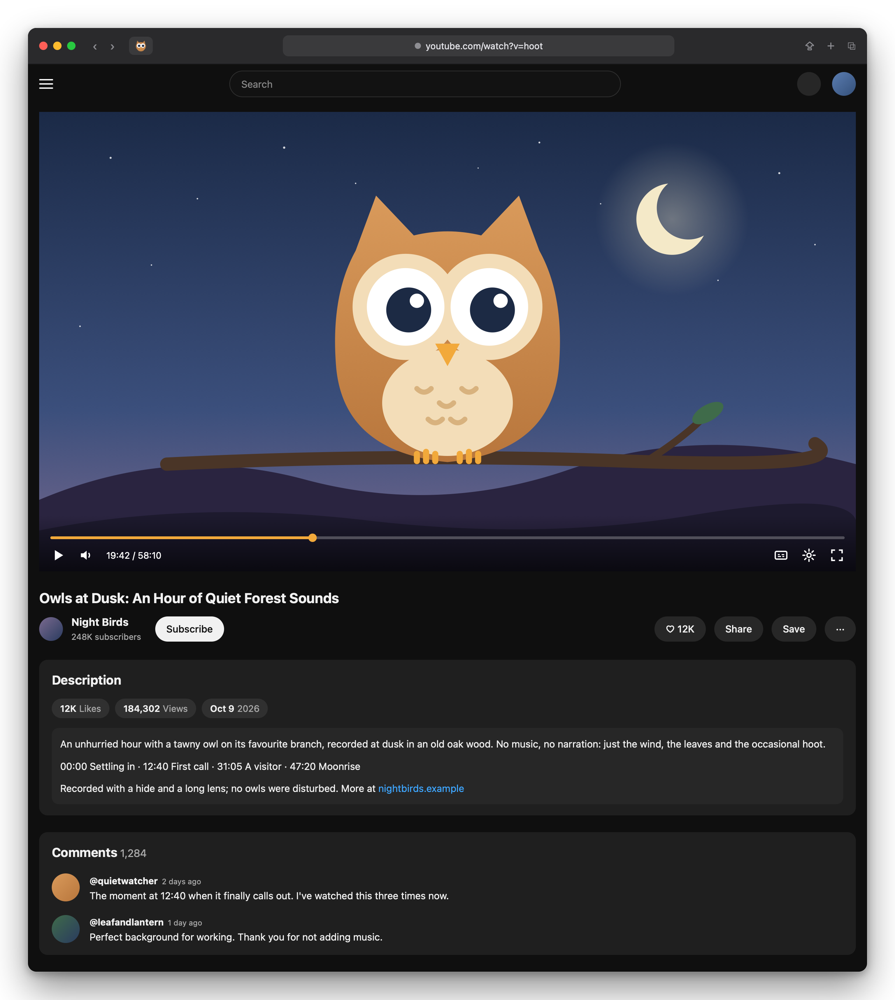

# Hoot

> **Beta.** Hoot is new and YouTube changes often, so expect the occasional rough edge, and please [report anything odd](../../issues).

A Safari extension that gives YouTube a calm, uncluttered watch page: the video at full width, then the title, description and comments.

<p align="center">
  
  <br><sub>Illustration of Hoot's layout (a mockup, not a screenshot).</sub>
</p>

No sidebar of suggestions, no chat, no end-screen video wall, no Shorts. Hoot is opinionated: it enforces one layout and keeps it working as YouTube changes, with a few switches for the things people disagree on, such as comments.

## Install

You need macOS 14 (Sonoma) or later and Safari 18.4 or later.

### With Homebrew (easiest)

```bash
brew install --cask mikebedar/tap/hoot
open -a Hoot
```

Then, in **Safari → Settings → Extensions**, tick **Hoot** and allow it on youtube.com. Update later with `brew upgrade --cask hoot`.

### Download

Grab `Hoot-<version>.zip` from the [latest release](../../releases/latest), unzip it, move **Hoot** to your Applications folder, and open it once. Then turn it on in Safari as above. The app is signed and notarized by Apple, so it opens without warnings.

### Build it yourself

If you'd rather build Hoot from the source code, you don't need to write any code. Apart from downloading Xcode, which is large, it takes a few minutes.

1. **Install Xcode** from the [Mac App Store](https://apps.apple.com/app/xcode/id497799835). It's free. Open it once and let it finish setting up.
2. **Add your Apple ID to Xcode:** go to **Xcode → Settings → Accounts**, click **+**, and sign in. A regular, free Apple ID is fine. Xcode uses it to sign Hoot so Safari will trust it.
3. **Get Hoot:** on this page, click **Code → Download ZIP** and unzip it. If you use git, cloning works too.
4. **Run the installer:** open **Terminal**, type `cd ` (with a space), drag the unzipped Hoot folder onto the Terminal window, press Return, and then run:
   ```bash
   zsh install.sh
   ```
   This builds Hoot, puts it in your Applications folder, and opens it. If your Apple ID belongs to more than one developer team, the installer asks which one to use.
5. **Turn Hoot on in Safari:** in **Safari → Settings → Extensions**, tick **Hoot**, then allow it on youtube.com.

That's it. Open any YouTube video.

To **update** a self-built Hoot, download the new source and run `zsh install.sh` again; your settings are kept.

To **uninstall**, untick Hoot in Safari's Extensions settings and drag Hoot out of your Applications folder (or run `brew uninstall --cask hoot`).

## Using Hoot

- **The layout is automatic.** On every video page you get the video at full width (never taller than your window), then the title, description and comments. The sidebar of suggestions, end-screen video walls, info cards and promo shelves are always hidden.
- **The owl button** in Safari's toolbar opens Hoot's settings:
  - **Enable Hoot**: the master switch. Turn it off to see YouTube as normal.
  - **Watch page**: hide comments, hide live chat and Ask (AI), auto-expand the description, turn off autoplay-next, and turn off YouTube's ambient glow behind the video.
  - **Site-wide**: hide Shorts everywhere, hide the home page feed, and hide the left navigation.
- **A sad owl** means YouTube served a page layout Hoot doesn't recognise. Rather than half-fix it, Hoot leaves that page exactly as YouTube made it. It tries again on the next page. If you keep seeing the sad owl, please [open an issue](../../issues).
- **In fullscreen**, Hoot's layout steps aside and YouTube sizes the video. The suggestion grid YouTube shows when you scroll in fullscreen stays hidden.
- **After Hoot updates**, refresh any YouTube tabs you already had open.

## Features

- **Single-column watch page** with a square, frameless, full-width player and the title, description and comments underneath at the same width.
- **Works with both YouTube layouts**: the classic one, and the 2026 redesign where description and comments live in slide-out side panels. Hoot shows those panels inline.
- **Fails safe**: if the page doesn't look the way Hoot expects, Hoot steps back on that page and shows the sad owl.
- **Survives live window resizing.** The layout is pure CSS keyed to YouTube's own layout state, so it never snaps back.

## When YouTube changes something

YouTube changes its page often and tests different layouts on different accounts, so something will occasionally slip through. Please [open an issue](../../issues). Include your Safari version, what you expected, what you saw, and a screenshot. Selector fixes are usually one line in `content.css`.

## Privacy

Hoot runs only on youtube.com. It stores your settings with the browser's extension storage, makes no network requests, and collects nothing.

---

## For developers

### Building

`install.sh` is the easiest way to build. To build directly, pass your own Apple developer team ID and a bundle ID prefix you own (the project's default, `net.bedar`, is registered to the maintainer's team):

```bash
xcodebuild -project Hoot/Hoot.xcodeproj -scheme Hoot -configuration Release \
  -derivedDataPath build -allowProvisioningUpdates \
  DEVELOPMENT_TEAM=YOURTEAMID BUNDLE_ID_PREFIX=com.yourname build
open build/Build/Products/Release/Hoot.app
```

You can also open `Hoot/Hoot.xcodeproj` in Xcode. Set your team under *Signing & Capabilities* for both targets, and change `BUNDLE_ID_PREFIX` once under the project's *Build Settings*.

If you build without a signing team, Safari only loads the extension after you enable **Develop → Allow Unsigned Extensions**, and you have to enable that again every time Safari restarts.

### Project layout

| Path | What it is |
|---|---|
| `extension/` | The web extension itself: `manifest.json`, `content.css` (layout rules), `content.js` (settings, theater/autoplay handling, the layout health check), `background.js` (re-applying after updates, toolbar owl), and the popup. **This is where nearly all changes go.** |
| `Hoot/` | The macOS wrapper app Safari requires, generated by `safari-web-extension-converter`. It references `extension/` directly rather than copying it. |
| `design/` | Source SVGs for the icons, plus `render.swift` to re-render them (`swift design/render.swift design/hoot-icon.svg <out-dir> icon 16 32 …`). |
| `docs/` | README images. They're rendered from the HTML mockups in `docs/mockups/` with `swift docs/mockups/render.swift docs/mockups/after.html docs/hoot-after.png`. |
| `install.sh` | Builds Hoot and installs it into `~/Applications`, picking a signing team automatically. |
| `scripts/release.sh` | Maintainer release script: Developer ID signing, notarization and stapling, then (with `--publish`) the GitHub release and the Homebrew cask in [mikebedar/homebrew-tap](https://github.com/mikebedar/homebrew-tap). |

After you change anything in `extension/`, rebuild and refresh the YouTube tab. You don't need to restart Safari.

Things worth knowing:

- **New files in `extension/` must be added to the Xcode project.** It lists them one by one (except `icons/`, which is a folder reference). A missing file shows up as an error under Safari → Settings → Extensions → Hoot.
- **Bump `version` in `manifest.json` to test the update path.** When the version changes, `background.js` re-applies Hoot to YouTube tabs that are already open. A rebuild at the same version doesn't trigger it, and those tabs keep the previous build until you refresh them. Each tab records the build it's running in `<html data-hoot-version>`.
- **Safari can take a minute or two to start a new version** after you rebuild.
- **Adding permissions in an update makes Safari ask users to approve Hoot again**, so avoid it once Hoot is public.

### Releasing

1. Bump `version` in `extension/manifest.json` (0.x versions are published as pre-releases), then commit and push.
2. Run `scripts/release.sh --publish`. It builds, signs with Developer ID, notarizes, staples and zips Hoot, then tags the commit, creates the GitHub release, updates `version` and `sha256` in the cask, pushes the tap, and checks that Homebrew can download and verify the release.

Add `--dry-run` to see the publishing steps first, and use `--publish-only` to re-publish an existing build if a step fails partway. Settings (team ID, notarization profile, tap, GitHub account) are read from the environment or a git-ignored `scripts/release.local.sh`; see the top of the script.

### How it works

- `content.js` reads your settings and sets `data-ytf-*` attributes on `<html>`. Every rule in `content.css` requires `data-ytf-enabled`, so toggles apply instantly, and dropping that one attribute (Hoot turned off, or the fail-safe) restores YouTube exactly.
- The selectors target YouTube's element ids and custom element tags (`ytd-watch-flexy`, `#secondary`, `#below`…) rather than its generated class names, which change far more often.
- On the redesign, the description and comments panels are moved below the video with CSS, not by moving DOM nodes, so YouTube's own scripts keep working. Comments load as you scroll down to them, as usual.
- After each watch-page load and resize, a health check confirms the title row (and, on the redesign, the description panel) sits under the video. If it still doesn't after about 8 seconds, Hoot falls back and the toolbar owl turns sad.

## License

[MIT](LICENSE).

Hoot is an independent project. It is not affiliated with, endorsed by, or sponsored by YouTube or Google. YouTube is a trademark of Google LLC.
